# CineMatch

**A movie recommender trained on 1 million MovieLens ratings that combines five ML techniques in one reproducible pipeline.**
Anomaly detection first removes bot-like raters, matrix factorization and item-to-item nearest neighbours
(item-kNN) are the core recommenders, a two-tower content model scores brand-new movies, K-means taste
profiles give brand-new users a starting point, and a contextual bandit (LinUCB) picks which of these
strategies to show each user in a click simulator. One command trains everything, one command evaluates
everything and writes every number in this README (including where a method does not beat a simple
baseline), and a local Streamlit app serves it all with numpy-only inference.

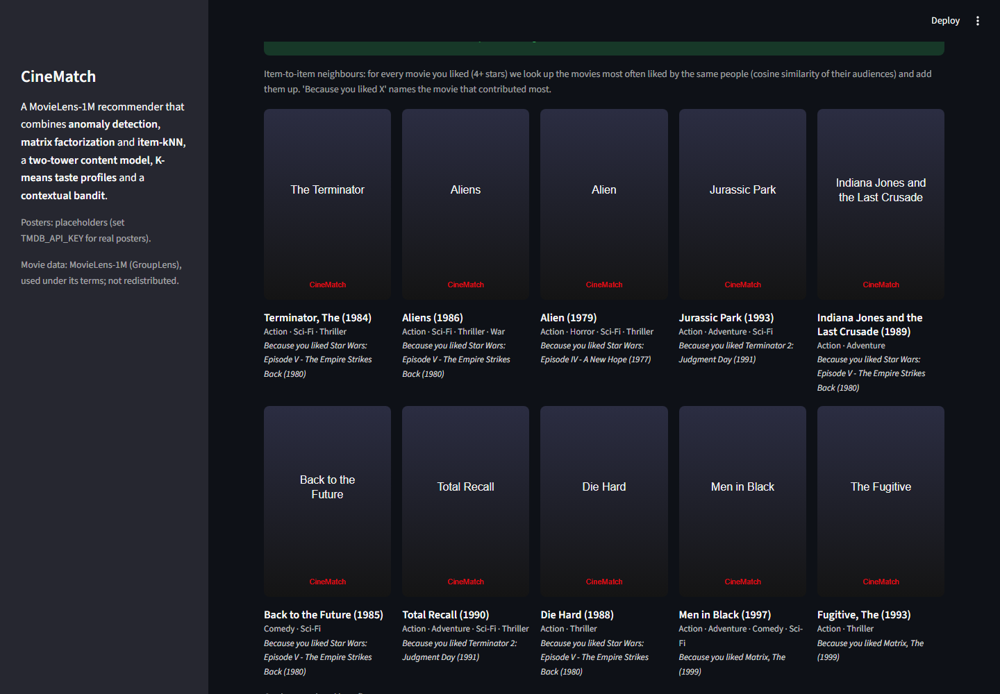

## Questions this project asks

1. Does a learned matrix factorization beat simple bias and popularity baselines, on rating error and on top-10 lists, and what does it take to beat popularity on top-10?
2. Can a model that only sees movie metadata rank movies nobody has rated yet, and how much of that is real personalization?
3. Can an unsupervised density model catch injected bot accounts, and which kinds slip through?
4. Can a contextual bandit learn which recommendation strategy to show, from simulated clicks?
5. (Stretch) Does a small deep Q-network learn a better order for a short session than simple heuristics?

The answers are in [Key findings](#key-findings); every number behind them is in [Results](#results).

## What it does

- **Anomaly detection:** a Gaussian density model over five per-user behaviour features flags bot-like raters (validated against five types of injected synthetic bots) and keeps them out of training. An engineered sixth feature is reported as an ablation.
- **Collaborative filtering:** matrix factorization (user/item vectors + biases) trained in PyTorch, compared against a bias baseline and a popularity baseline. Top-10 lists are ranked either by MF's predicted rating plus a popularity prior or by item-kNN (cosine similarity between movies, computed from who liked them); the prior weight and the number of neighbours are chosen on the validation split. A simulation of new users with only a few known ratings evaluates exactly what the app does.
- **Content-based two-tower model:** genre, year and title features let it score movies nobody has rated yet (cold-start items). On those movies it is compared with the baselines that are possible there (see Results).
- **Taste profiles:** K-means on the MF user vectors gives taste profiles, each named after its most over-represented genres, that serve new users who pick a profile.
- **Contextual bandit:** LinUCB vs epsilon-greedy vs random choose which strategy fills a user's list, scored by a click simulator built from held-out ratings, with "always serve the best single strategy" as a reference. Hyperparameters are tuned on simulated users disjoint from the reported ones. Both learners beat random; the Results section states whether they beat that reference (in the current run they do not).
- **Stretch goal, DQN:** a small deep Q-network that orders a 5-slot session (see [Results](#results)).

**The app** has four tabs: *Get Recommendations* (rate a few movies and get picks from *Similar movies
(item-kNN)*, the default, *Matrix factorization* or *Content (two-tower)*, each card with a "why" and no
score, ordered best first; or pick a taste profile), *Explore Taste Profiles*, *Bandit Lab* (run the
policies live and watch the regret curves) and *How It Works* (results tables, including the new-user
simulation, figures and an interactive anomaly-score demo).

**Stack:** Python 3.11, PyTorch (CPU), numpy, pandas, scikit-learn, Streamlit, Plotly, pytest.

## Architecture

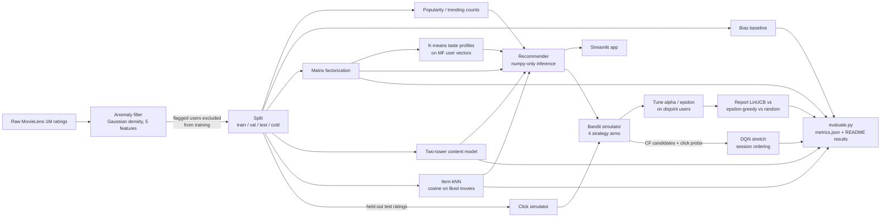

## Results

All numbers below are written by `scripts/evaluate.py` from `reports/metrics.json`; nothing is hand-typed.

*Glossary:* RMSE = rating-prediction error (lower is better). P@10 = share of the top-10 list the user
actually liked; R@10 = share of the user's liked movies that made the top-10; NDCG@10 = like P@10 but
hits near the top count more. mu, b_u, b_i = global mean rating, user bias, movie bias. Regret = clicks
lost against always picking the best strategy for each user (lower is better).

<!-- RESULTS:START -->
**Headline results** (held-out data):

- **Rating prediction:** matrix factorization test RMSE 0.8887 vs 0.9323 for the bias baseline (lower is better).
- **Top-10 ranking** (warm movies): NDCG@10 item-kNN 0.0683, MF + popularity prior 0.0608, popularity 0.0532, MF ranked by its predicted rating 0.0287.
- **New users** (simulated, 5 known ratings): item-kNN NDCG@10 0.0586 vs 0.0517 for popularity.
- **Brand-new movies:** the two-tower model ranks them with NDCG@10 0.1309 vs 0.0512 for random ranking and 0.1209 for a non-personalized genre-popularity ranking.
- **Bot detection:** test F1 0.7317 on synthetic bots (precision 0.9375, recall 0.6000; misses 2 of 5 bot types).
- **Contextual bandit:** LinUCB's cumulative regret is 37% below random (244.9006 vs 389.0596, simulated clicks), but it does not beat always serving the best single strategy.

**Data:** MovieLens-1M, 6,040 users, 3,883 movies (183 held out as cold-start items). Split: per-user time-aware 80/10/10 train/val/test, 6% of movies with >= 20 ratings held out as cold items, seed 42: 753,429 train / 90,822 validation / 90,822 test / 65,136 cold ratings. 31 users flagged by anomaly detection are excluded from model training and from the ranking-evaluation sample (RMSE uses all held-out rows). Ranking metrics use a fixed seeded sample of 2,000 test users; a held-out rating >= 4 counts as relevant.

**Warm movies** (test split; ranking over warm candidates not in the user's train set):

| Model | RMSE | P@10 | R@10 | NDCG@10 |
|---|---|---|---|---|
| Popularity | n/a | 0.0385 | 0.0516 | 0.0532 |
| Bias baseline (mu + b_u + b_i) | 0.9323 | 0.0139 | 0.0144 | 0.0179 |
| Matrix factorization (ranked by predicted rating) | 0.8887 | 0.0216 | 0.0300 | 0.0287 |
| MF + popularity prior (beta = 1, chosen on validation) | n/a | 0.0424 | 0.0595 | 0.0608 |
| Item-kNN (k = 200, chosen on validation) | n/a | 0.0463 | 0.0680 | 0.0683 |
| Two-tower content model | 0.9839 | 0.0045 | 0.0071 | 0.0053 |

- MF: dim 32, best epoch 12 (early stopping on validation RMSE).
- Popularity has no rating prediction (RMSE n/a).
- MF + popularity prior is the same MF model ranked by predicted rating + beta x log(1 + the movie's train rating count); its rating predictions are MF's.
- Item-kNN scores a movie by its cosine similarity to the movies the user rated >= 4 (top-k neighbours per movie) + gamma x log(1 + train rating count), gamma = 0; it predicts no rating (RMSE n/a).
- beta, k and gamma were chosen by NDCG@10 on the validation split; the test split was not used to choose them.

**New users (simulated, 5 known ratings)** (test split; the app's rate-a-few-movies flow):

| Strategy | P@10 | R@10 | NDCG@10 |
|---|---|---|---|
| Popularity | 0.0368 | 0.0518 | 0.0517 |
| MF fold-in (ranked by predicted rating) | 0.0241 | 0.0312 | 0.0337 |
| MF fold-in + popularity prior | 0.0392 | 0.0567 | 0.0548 |
| Item-kNN on the liked seed movies | 0.0388 | 0.0675 | 0.0586 |

- 943 sampled users; each one's only known ratings are 5 random train ratings of well-known movies (many train ratings), scored exactly as the app scores a new user (MF fold-in, or item-kNN on the seeds rated >= 4, else >= 3, else popularity). Candidates are well-known warm movies the user has not rated in train; a test rating >= 4 counts as relevant.

**Cold-start movies** (never seen in training; MF cannot score them by construction):

| Cold-start model | RMSE | P@10 | R@10 | NDCG@10 |
|---|---|---|---|---|
| Two-tower content model | 1.0210 | 0.0997 | 0.1602 | 0.1309 |
| CF fallback: user bias only (mu + b_u, item bias unknown) | 1.0615 | n/a | n/a | n/a |
| Genre popularity (non-personalized) | n/a | 0.0951 | 0.1420 | 0.1209 |
| Random ranking (mean of 10 seeds) | n/a | 0.0398 | 0.0539 | 0.0512 |

- Ranking over cold candidates only, 1,850 sampled users with a relevant cold rating. The CF fallback row is what the bias/MF models predict for an unseen movie (item bias unknown; RMSE only, it gives every unseen movie the same score, so it cannot rank); the other rankings use exactly the same users and candidates.
- Genre and popularity priors alone (no personalization) reach NDCG@10 0.1209 vs the two-tower's 0.1309. So 87% of the two-tower's NDCG@10 gain over random comes from these priors and the rest from personalization.

**Anomaly detection:** Gaussian density over 5 behaviour features; a user is flagged when the log-density falls below a threshold epsilon chosen by validation F1. Test set: 150 synthetic bots + held-out real users. Real users flagged and excluded: 31.

| Metric | 5 features (deployed) | + item-deviation feature (ablation) |
|---|---|---|
| Validation F1 | 0.7317 | 0.7317 |
| Test precision | 0.9375 | 0.9184 |
| Test recall | 0.6000 | 0.6000 |
| Test F1 | 0.7317 | 0.7258 |
| Recall on `push` bots | 1.0000 | 1.0000 |
| Recall on `nuke` bots | 1.0000 | 1.0000 |
| Recall on `random_spam` bots | 0.0000 | 0.0000 |
| Recall on `camouflage_popular` bots | 0.0000 | 0.0000 |
| Recall on `camouflage_slow` bots | 1.0000 | 1.0000 |

- Bot types the deployed model misses (test recall below 0.5): `random_spam`, `camouflage_popular`.
- Ablation: the same protocol with a 6th engineered feature, the mean absolute deviation of a user's ratings from each movie's mean, tried after error analysis on validation bots. It did not improve test F1 (0.7258 vs 0.7317): the missed bots mimic real users' rating statistics, so catching them needs item-level / co-rating graph signals. Test bots come from the same synthetic generator, so this measures detection of these patterns, not real-world abuse.

**Taste profiles:** K-means on MF user vectors, k = 4 (silhouette 0.0656): Action & Sci-Fi fans (1,174), Mainstream (1,901), Romance & Children's fans (1,324), Drama & Film-Noir fans (1,641).

**Contextual bandit** (20,000 rounds x 5 seeds, simulated clicks):

| Policy | Mean reward | Cumulative regret (± std) |
|---|---|---|
| Random | 0.0262 | 389.0596 ± 7.9565 |
| Epsilon-greedy | 0.0337 | 240.0854 ± 13.9208 |
| LinUCB | 0.0334 | 244.9006 ± 16.8127 |
| Always the best single arm (CF; reference, not a learner) | 0.0349 | 214.9356 ± 3.0395 |

- Neither learner beats always serving the best single strategy (CF) within 20,000 rounds, so the user context does not pay off yet in this simulation.
- LinUCB and epsilon-greedy differ by less than two standard errors over 5 seeds, i.e. within seed noise.
- Hyperparameters tuned on 1,000 simulated users disjoint from the reported ones (lowest mean cumulative regret): LinUCB alpha = 0.01, epsilon-greedy epsilon = 0.05.
- 59.6% of simulated users have no click signal (none of their arms' lists contains a movie they rated in the test split, so every arm has the same expected reward); only the remaining users can separate the policies.

**DQN stretch goal** (order a 5-slot session from 8 CF candidates; simulated position decay and genre fatigue make the order matter):

| Ordering policy | Mean expected session reward |
|---|---|
| DQN (greedy policy) | 0.3407 |
| Diversity heuristic | 0.4649 |
| CF order | 0.4298 |
| Random order (mean of 20 orders) | 0.3759 |
| Oracle (best 5-item sequence per user, upper bound) | 0.8199 |

- Expected (analytic) clicks per session on 128 held-out users with click signal; the DQN was trained on 128 other users for 3,000 episodes. Only 256 of 1,000 simulated users (26%) have any click signal among the candidates.
- On held-out users the DQN does not beat the diversity heuristic and CF order and random order.

<details>
<summary>Anomaly and bandit details</summary>

- Anomaly threshold: log-density epsilon -17.7395 (chosen by validation F1); ablation epsilon -25.5033.
- Bandit: oracle mean reward 0.0458; mean expected reward per arm: CF 0.0352, content 0.0126, taste-profile favourites 0.0334, trending 0.0248.
- Tuning grid for LinUCB alpha (mean cumulative regret on the tuning users): 1: 266.1725, 0.3: 236.0220, 0.1: 231.6335, 0.03: 223.1720, 0.01: 203.0455.
- Tuning grid for epsilon-greedy epsilon (mean cumulative regret on the tuning users): 0.2: 241.3590, 0.1: 206.4155, 0.05: 205.3950, 0.02: 263.3275.

</details>

Training time: 100s, the sum of the step times (anomaly 3s, data 6s, cf 25s, content 23s, clustering 3s, bandit 17s, dqn 24s).

**Key figures:**

<p>
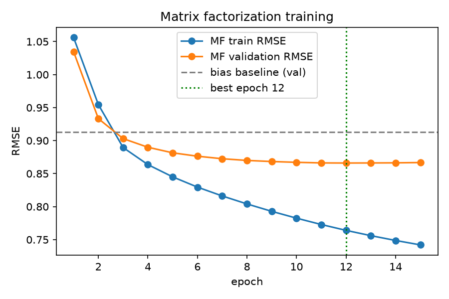
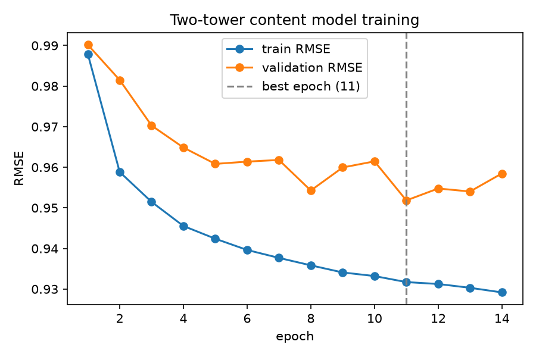
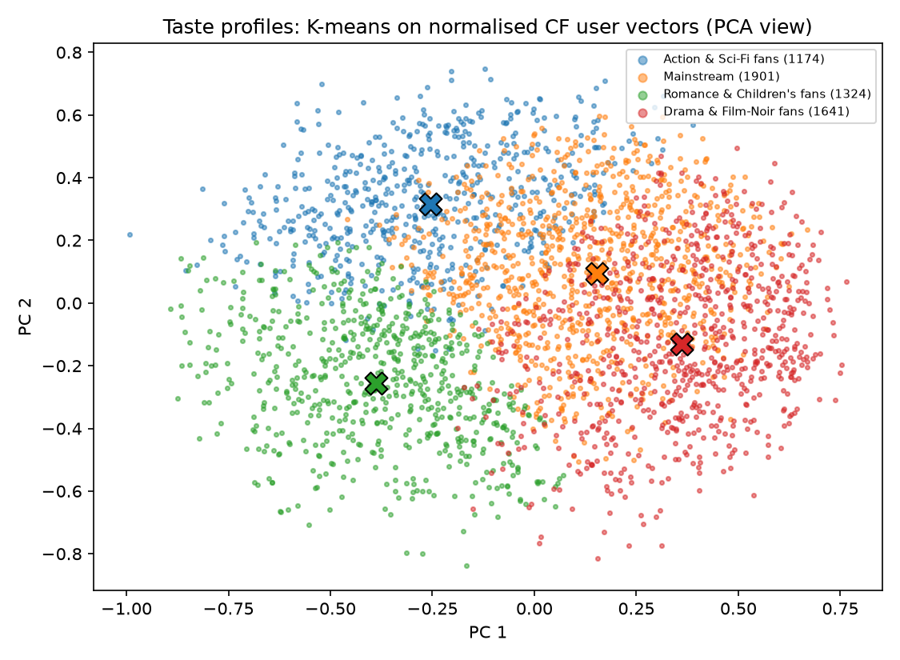
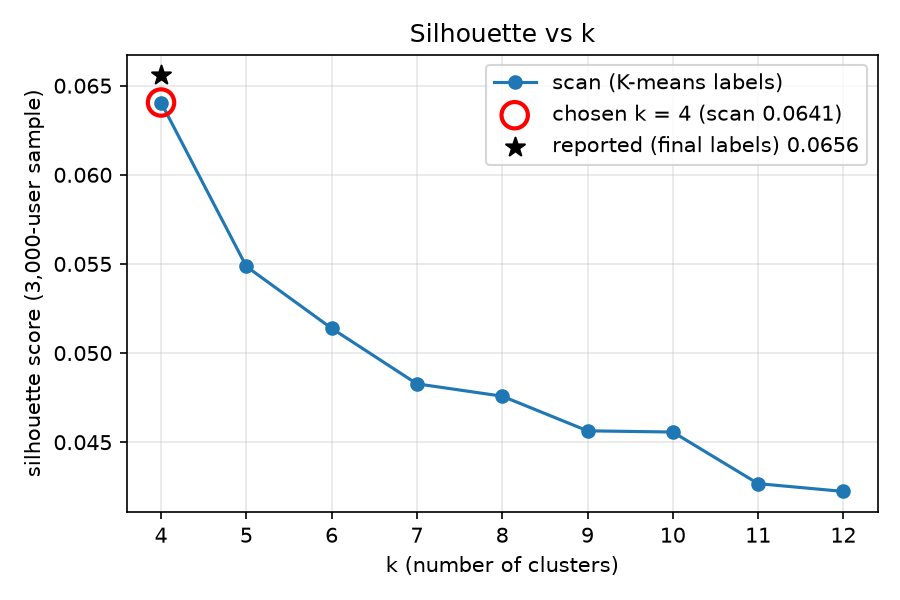
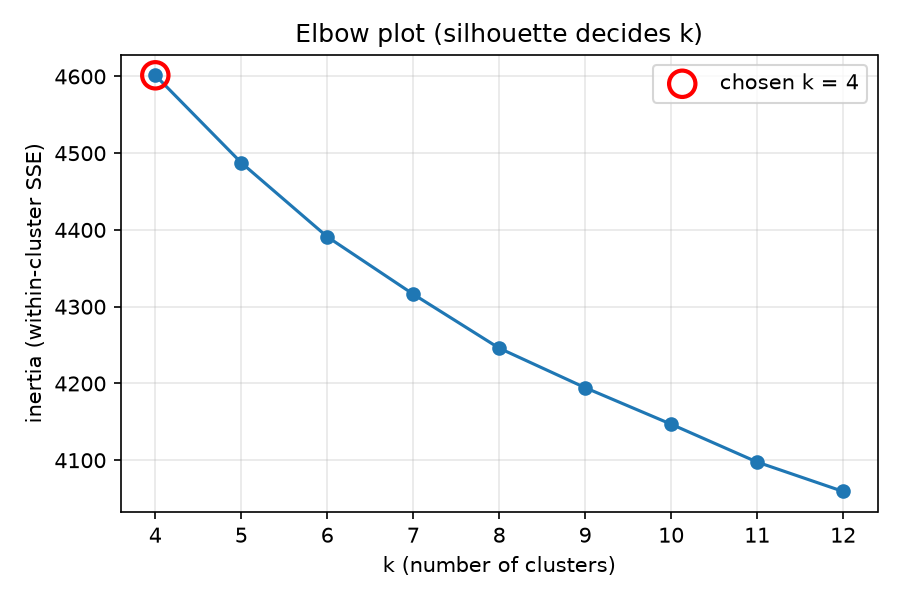
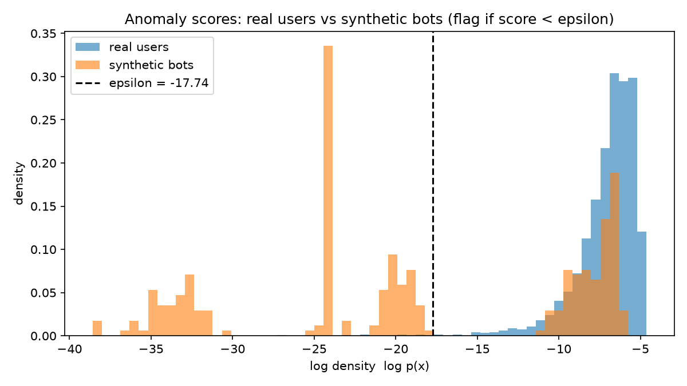
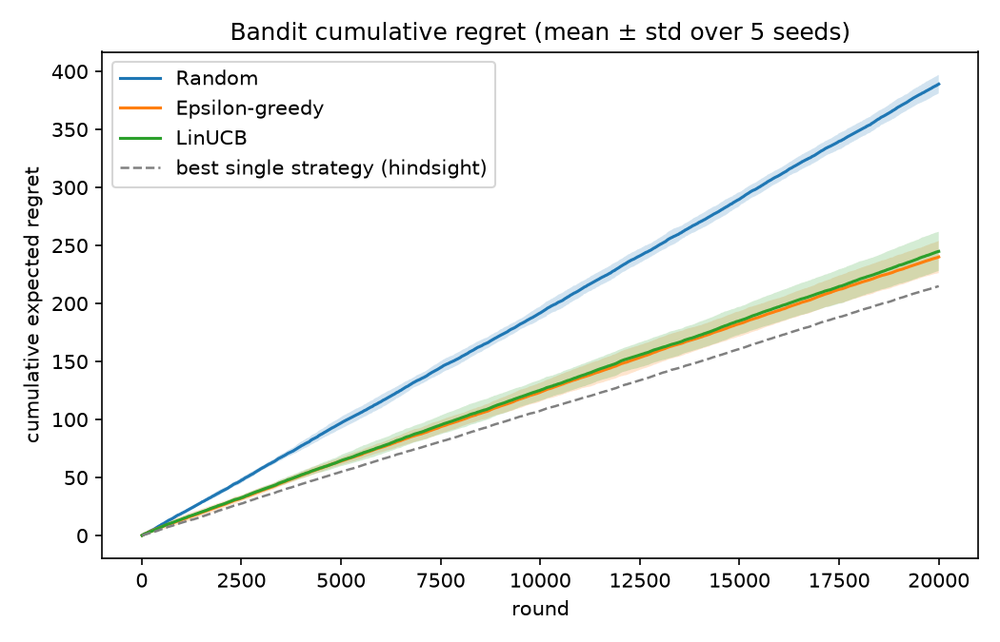
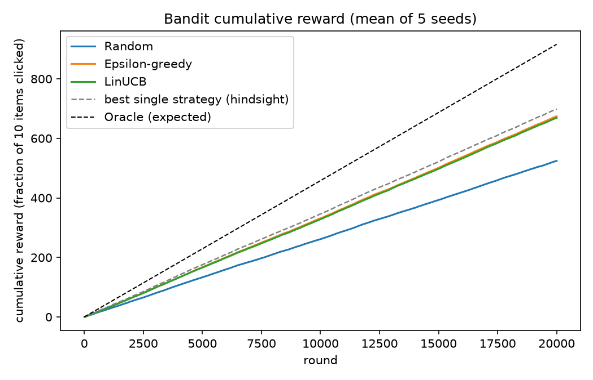
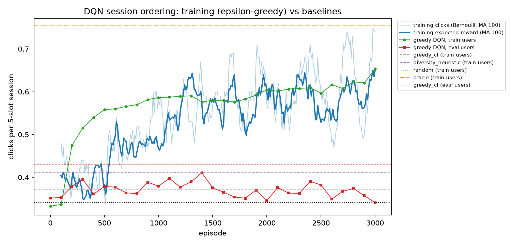
</p>

_Generated by `scripts/evaluate.py` at 2026-10-19T15:16:35+00:00 from `reports/metrics.json`._
<!-- RESULTS:END -->

### Key findings

- **MF has the best rating error, but ranked by predicted rating it loses to popularity on top-10.**
  MF is trained to predict star ratings, and for ranking its prediction is dominated by the movie's own
  bias (how far above average the movie is rated). The highest biases belong to films that a handful of
  fans rated 5 stars, so every user gets almost the same list of little-watched "critics' favourites". A
  top-10 hit, however, needs the user to have watched the movie at all, and people mostly watch well-known
  movies: the predicted rating answers "how much would you like it if you saw it", not "will you see it
  and like it". Two fixes use exactly the signal it ignores. Adding a popularity prior (predicted rating +
  beta x log of the movie's rating count, with beta chosen on the validation split) shrinks the list
  toward movies many people saw. Item-kNN recommends the movies most often liked by the same people who
  liked yours, so it is personal and popular at once. Both beat popularity on the warm table; the plain MF
  row stays in the table as the finding, and the new-user table shows the same comparison in the app's own
  scenario (a handful of ratings).
- **The two-tower model is the cold-start model.** It is weak on movies that already have ratings. On
  movies nobody has rated, the CF fallback (mu + b_u) gives every movie the same score and cannot rank, so
  the fair comparison is with random ranking and, more strictly, with a non-personalized ranking by
  genre popularity when it is in the table: part of the lift over random comes from such genre and
  popularity priors rather than from personalization.
- **Bandit rewards are small** because most simulated users have few test ratings among the recommended
  movies, so many users carry no signal about which arm is better (the exact share is in the bandit notes
  above). Beating random is the easy part; the meaningful reference is always serving the single best
  strategy, and the bandit notes say whether the learners beat it.
- **Bot detection catches blatant bots, not camouflaged ones.** Bots with extreme rating patterns are
  flagged reliably, but two camouflaged types look like real users on per-user summary statistics, and an
  extra engineered feature did not close the gap (see the ablation column).
- **The DQN learns, but does not beat a simple heuristic.** It fits its few training users far better than
  new ones, and on held-out users it does not beat a hand-written diversity rule; how it compares with CF
  order and random order is stated in the DQN notes in Results.
- **Taste profiles are a coarse segmentation.** The silhouette score is low for every k: user tastes form a
  continuum rather than separate groups, so the profiles are useful starting points, not discovered types.

## ML techniques → where they're used

The project spans three areas of machine learning (unsupervised learning, recommender systems and
reinforcement learning), plus the engineering around them.

| Area | Technique | Where in the code |
|---|---|---|
| Unsupervised learning | K-means clustering, elbow + silhouette | `src/cinematch/clustering.py`: `fit_kmeans_range`, `choose_k`, `name_clusters`, `assign_cluster` |
| Unsupervised learning | Anomaly detection (Gaussian density, epsilon chosen by F1) | `src/cinematch/anomaly.py`: `user_features`, `inject_bots`, `fit_gaussian`, `log_density`, `select_epsilon`, `cap_epsilon` |
| Unsupervised learning | PCA (2-D visualisation of taste profiles) | `src/cinematch/clustering.py`: `_plot_pca` |
| Recommender systems | Collaborative filtering / matrix factorization | `src/cinematch/cf.py`: `build_mf`, `train_mf`, `BiasBaseline`, `fold_in_user`, `rank_scores` |
| Recommender systems | Item-based nearest neighbours (cosine item-kNN) | `src/cinematch/cf.py`: `build_item_knn`, `knn_scores`, `knn_top_contributor` |
| Recommender systems | Content-based filtering (two-tower network) | `src/cinematch/content.py`: `build_two_tower`, `train_two_tower`, `user_profile_features` |
| Reinforcement learning | Exploration vs exploitation: contextual bandit (epsilon-greedy, LinUCB) | `src/cinematch/bandit.py`: `BanditEnv`, `RandomPolicy`, `EpsilonGreedy`, `LinUCB`, `precompute_env`, `tune_params`, `run_all` |
| Reinforcement learning | Deep Q-network with replay buffer + target network (stretch) | `src/cinematch/dqn.py`: `build_qnet`, `ReplayBuffer`, `train_dqn`, `diversity_orders` |
| Supporting | Item features (genres, year, title TF-IDF -> SVD) | `src/cinematch/data.py`: `build_item_features` |
| Supporting | Time-aware train/val/test split + cold-item holdout | `src/cinematch/data.py`: `split_ratings` |
| Supporting | Evaluation metrics (RMSE, P@10, R@10, NDCG@10) | `src/cinematch/metrics.py`: `rmse`, `precision_recall_ndcg_at_k`, `rank_eval` |
| Supporting | Serving (numpy-only inference) | `src/cinematch/recommend.py`: `Recommender.recommend_from_ratings`, `Recommender.recommend_strategy` |

## Design decisions

1. **Dataset:** MovieLens-1M (6,040 users, ~3,900 movies, 1,000,209 ratings); downloaded by `scripts/download_data.py`, never committed (GroupLens license).
2. **Split:** per-user time-aware holdout on the warm (non-cold) ratings: each user's ratings sorted by timestamp; last 10% -> test, previous 10% -> validation, rest -> train, with at least 1 test and 1 validation rating per user. The split is time-ordered within each user only: training still contains other users' ratings made after a given user's test period, so popularity and trending signals can see the future relative to that user (a global-time split would be stricter). Every ML-1M user has >= 20 ratings, but a few users have fewer than 20 warm ratings once the cold-start movies are held out. Seed 42 everywhere.
3. **Cold-start items:** 6% of the movies with >= 20 ratings are held out entirely (all their ratings removed from train/val/test and placed in a `cold` split). Only the two-tower model can rank them; it is compared there with random ranking and a non-personalized genre-popularity baseline on the same users and candidates, and with the CF fallback (mu + b_u, RMSE only). CF cannot score unseen items by construction.
4. **Anomaly detection runs first.** A Gaussian density over five per-user behaviour features (log rating count, mean, variance, share of 1/5 ratings, log ratings per day; computed from raw ratings before splitting) is fitted on 60% of real users, and the threshold epsilon is tuned by F1 on real users plus synthetic bots. Flagged real users (capped at 3%) are left out of CF/content training and of the evaluation-user sample. Error analysis on the *validation* bots showed two bot types evade the model; an engineered item-agreement feature (mean absolute deviation from each movie's mean rating) did not close the gap and is reported as an ablation. Those bots mimic real users' rating statistics, so catching them would need item-level or co-rating graph signals (future work).
5. **Relevance for ranking metrics:** a held-out rating >= 4 counts as relevant; candidates = all warm items not in the user's train set; metrics are P@10, R@10, NDCG@10 (binary gain) plus RMSE on held-out ratings. beta (MF popularity-prior weight), k (number of neighbours) and gamma (kNN popularity weight) are chosen by validation NDCG@10 inside `cf.train_step`; the taste-profile weights (`cluster_taste_weight`, `cluster_pop_weight`) and the content strategy's popularity weight (`recommend.CONTENT_POP_WEIGHT`) are fixed constants picked in a one-off validation experiment that is not part of `train_all.py`. The test split only reports.
6. **CF = classic MF** (user/item vectors + biases + global mean, regularized MSE) trained with mini-batch Adam in PyTorch, early stopping on validation RMSE; L2 reg 0.05 and learning rate 2e-3 were picked by validation RMSE in a small manual sweep that is not part of `train_all.py`; dim 32 is fixed. Baseline = global mean + regularized user/item biases (closed form, alternating).
7. **Ranking rules are separate from rating prediction.** MF's predicted rating is kept for RMSE, but ranked by it MF recommends the movie bias, so top-N lists use `cf.rank_scores` = predicted rating + beta x log(1 + train rating count). Item-kNN is the second ranker: cosine similarity between movies over the binary "liked" (train rating >= 4) matrix of non-flagged users, keeping the k most similar neighbours per movie (a sparse matrix in `models/item_knn.npz`); a user's score for a movie is the sum of its similarities to the movies they liked + gamma x log(1 + count). beta, k and gamma are picked from small grids by NDCG@10 on the validation split (same evaluation users, candidates = warm movies not in train) and saved in `models/cf_ranking.json`. A ranking loss (BPR) was considered and not used: it needs early stopping on a ranking metric and more code, and in a one-off validation experiment (not part of `train_all.py`) it did not beat item-kNN.
8. **The new-user simulation is the evaluation that matches the app.** For a seeded sample of evaluation users, a few random train ratings of well-known movies (at least `new_user_min_train_ratings` train ratings) are the only known ratings, and each strategy scores them exactly as the app scores a new user: MF fold-in by closed-form ridge regression (reg 10), with or without the popularity prior, item-kNN on the seeds rated >= 4 (else >= 3, else popularity), and popularity. Candidates are the well-known warm movies the user did not rate in train; a test rating >= 4 counts as relevant.
9. **Two-tower** uses only genre multi-hot + scaled year + a title TF-IDF->SVD(16) vector for items (no sentence-transformers: no extra deps, offline-friendly), and rating-derived profile features for users; dot-product + global bias trained on rating MSE. The title TF-IDF/SVD is fit on all movie titles (including cold items); this is unsupervised metadata, not ratings, so no rating information leaks into the cold split.
10. **Taste profiles:** K-means on L2-normalised CF user vectors, scanned for k = 4..12. The chosen k has the best silhouette among k = 4..8 (enough profiles to choose from, few enough to read) with >= 3% of users in every cluster. Each profile is named after its top-2 over-represented genres among its ratings >= 4, measured in percentage points (pp) against all users ("G1 & G2 fans"), or "Mainstream" if no genre is over-represented by 2 pp. Silhouette is low for every k, so the profiles are a coarse segmentation of a continuous taste space; the elbow plot is shown for transparency.
11. **Bandit clicks are simulated**, not real: p(click | test-split rating r) = {1:0.02, 2:0.05, 3:0.15, 4:0.45, 5:0.75}; unrated item p = 0.01 (validation ratings are never used, since they tuned early stopping). Regret is exact (expected reward per arm per user is computed analytically). The four arms are the Recommender strategies (CF, content, taste-profile popular, trending); LinUCB uses the context [1, log rating count, mean rating, rating std, one-hot taste profile]. The reported horizon is 20,000 rounds per seed, and the learners are compared not only with random but with always serving the best single strategy, chosen in hindsight (an oracle reference no learner can pick in advance).
12. **Bandit hyperparameters are tuned on disjoint users:** LinUCB alpha and epsilon-greedy epsilon are picked by the lowest mean cumulative regret on 1,000 simulated users that are not flagged and not in the evaluation sample, with their own seeds; the reported run on the evaluation users only uses the chosen values.
13. **App inference is numpy-only** (weights and the sparse similarity matrix exported to `.npz`). *Rate movies* offers three strategies: *Similar movies (item-kNN)*, the default because it stays personal with only a few ratings and its explanations are literally true, uses the seeds rated 4-5 (else 3, else popularity); *Matrix factorization* folds the user in with closed-form ridge regression and ranks with the popularity prior; with only a few ratings the fold-in vector is weak, so its list is mostly well-known films liked by people with similar ratings and overlaps a lot with the popularity list (it becomes more personal as you rate more; item-kNN is the personal option for a new user); *Content (two-tower)* adds a small popularity prior on warm movies and is the only strategy that can show brand-new movies. For brand-new users, warm movies need at least `new_user_min_train_ratings` train ratings to be recommended. The earlier hybrid (z-scored CF + content) was removed: for new users it was worse than CF alone, because the content score is weak on warm movies. Cards show no number: kNN similarities and popularity-boosted scores are not ratings, so only the order (best first) is shown. Each card's "why" is checked: item-kNN names the liked movie that contributes most, MF names a liked movie only when it is really similar (cosine >= 0.5) and otherwise says "Popular with people whose ratings resemble yours", and content names only the user's top-2 favoured genres. Taste-profile lists score movies by mu + b_i + a taste term (MF item vectors x the profile centroid) + a popularity term, with weights in `config.py`, so each profile gets its own list instead of the same critics' favourites.
14. **DQN is a stretch:** a small Q-network (MLP with action masking, replay buffer, target network) learns the order of a 5-slot session from 8 CF candidates in a simulated session where each later slot is seen less (position decay 0.85) and repeated genres tire the user (fatigue 0.80 per overlapping item already shown). It is compared analytically with CF order, random order and a diversity heuristic.
15. **Every number in the README is written by `scripts/evaluate.py`** between the `RESULTS:START` / `RESULTS:END` markers; nothing is hand-typed (a test fails if a 4-decimal number appears outside them).

## Limitations

- **The bandit shows no gain from context yet.** Clicks are simulated from held-out ratings, not logged from real users. Both learners beat random, but within the simulated rounds neither beats always serving the best single strategy, and LinUCB vs epsilon-greedy is within seed noise. Most simulated users have no click signal at all (none of their recommended movies has a test rating), so there is little to personalize on.
- **The DQN overfits its few training users.** It is trained and evaluated on simulated sessions with assumed position-decay and fatigue dynamics, and only on the small share of users with any click signal. It learns its training users' sessions well, but on held-out users it does not beat the simple diversity heuristic (the DQN notes in Results compare it with CF order and random order); more users or a smaller network would be needed.
- **MF's predicted rating is not a ranking score:** ranked by it, MF loses to popularity on top-10. The shipped rankers fix this with a popularity prior or item-kNN, which also pull lists toward well-known films: accuracy improves, discovery of niche titles goes down, and no diversity or novelty metric is reported.
- **MF is tuned for RMSE:** its hyperparameters were chosen by validation RMSE; the ranking is corrected afterwards (prior, kNN) rather than by training with a ranking loss.
- **The new-user simulation is an approximation:** the seed ratings are sampled from each user's real train ratings of well-known movies, not chosen the way a person picks from the app's grid, and it uses a sample of users.
- **Item-kNN only knows movies people liked in training:** it cannot score brand-new movies (the content strategy covers those) and a user who likes nothing gets popularity.
- **MF cannot score cold items** (movies with no training ratings); only the two-tower model covers them.
- **The content model is weak on warm ranking:** with genres, year and title only it is far behind MF and Popularity on movies that already have ratings; it exists as the cold-start model (the app's content strategy adds a small popularity prior on warm movies).
- **Taste profiles are coarse:** the silhouette score is low for every k, so clusters are a convenient segmentation for cold-start users, not natural groups.
- **Two bot types go undetected** (`random_spam`, `camouflage_popular`): their summary statistics look like real users'. All bots are synthetic and the test bots come from the same generator as the validation bots, so detection numbers say nothing about real-world abuse. Many real ML-1M users rated everything in a single session, so a high ratings-per-day rate alone is only weakly anomalous.
- **Ranking metrics use a sample:** a fixed seeded sample of 2,000 test users, so all models are compared on identical users; users with no relevant held-out movie are skipped by the ranking average.
- **Thin item content:** genres, year and title only; no plot overviews or sentence embeddings.
- **The split is per-user, not global in time:** each user's test ratings are their latest, but training contains other users' later ratings, so popularity and trending signals can see the future relative to a user's test period. A global-time split would be stricter and would likely lower the popularity-based numbers.
- **Flagged users** keep their rows in `ratings_split` but are not used for training or for the ranking-evaluation sample (RMSE uses all held-out rows, including theirs). Their MF vectors are untrained noise, so their MF scores and taste-profile labels are meaningless.

## Future work

- **Stricter evaluation:** a global-time split, so no model can learn from ratings made after a user's test period.
- **Ranking-oriented training:** a pairwise ranking loss (e.g. BPR) or implicit-feedback ALS, compared with item-kNN on the same validation protocol.
- **Beyond accuracy:** diversity, novelty and catalogue-coverage metrics, since the popularity prior trades discovery for accuracy.
- **Richer item content:** plot summaries or text embeddings for the cold-start model, to see how much personalization metadata can carry beyond genre and popularity priors.
- **Harder bot detection:** item-level and co-rating graph features aimed at the camouflaged bot types the per-user density model misses.
- **Bandit and DQN:** off-policy evaluation on logged data instead of a click simulator, and more users with click signal (or less user-specific state) so the DQN can generalise.

## How to run locally

**Requires Python 3.11** (the pinned numpy and pandas need >= 3.11); create the virtual environment with a
3.11 interpreter explicitly, not whatever `python` is on PATH.

Windows PowerShell (PowerShell 5.1 has no `&&`; `if ($?)` runs `evaluate.py` only when training succeeded):

```powershell
py -3.11 -m venv .venv
.venv\Scripts\python.exe -m pip install -r requirements.txt
.venv\Scripts\python.exe scripts\download_data.py
.venv\Scripts\python.exe scripts\train_all.py; if ($?) { .venv\Scripts\python.exe scripts\evaluate.py }
.venv\Scripts\python.exe -m pytest -q
.venv\Scripts\python.exe -m streamlit run app\streamlit_app.py
```

macOS / Linux (bash):

```bash
python3.11 -m venv .venv && source .venv/bin/activate
pip install torch==2.14.1 --index-url https://download.pytorch.org/whl/cpu   # CPU wheel, skips the CUDA packages
pip install -r requirements.txt
python scripts/download_data.py
python scripts/train_all.py && python scripts/evaluate.py
pytest -q
streamlit run app/streamlit_app.py
```

- **Time:** a full `train_all.py` takes about a minute on an 8-core CPU; `evaluate.py` a few seconds.
- **Smoke mode:** `python scripts/train_all.py --fast` and `python scripts/evaluate.py --fast` run in a fraction of the time with tiny epochs. Warning: a fast evaluate overwrites `reports/metrics.json` and the README results block with non-final numbers (marked with a FAST MODE banner); rerun the full `train_all.py` + `evaluate.py` before committing.
- **Tests:** the pytest suite builds its own tiny synthetic data and runs in seconds; `tests/test_integration.py` additionally checks the real artifacts (metrics.json, README block, figures) and skips when they have not been generated.
- **Reproducibility:** results are bit-identical on the same machine, torch build and thread count (`config.TORCH_THREADS`). A different operating system or torch build gives slightly different numbers, which is why the README results are always regenerated by `evaluate.py` instead of being typed in.
- **Posters (optional):** set `TMDB_API_KEY` to show posters from TMDB; without it the app uses offline placeholders. Setting `CINEMATCH_REPO_URL` adds a link to the source repository in the sidebar.
- **PyTorch on CPU:** `requirements.txt` pins `torch` without a `+cpu` suffix so it installs on Windows from PyPI (a CPU build there). On Linux the PyPI wheel is the CUDA build with several GB of NVIDIA packages, so the bash steps install the CPU wheel from the PyTorch index first; the pin is then already satisfied.

## Repo layout

```
cinematch/
  README.md, LICENSE, requirements.txt, pyproject.toml, .streamlit/config.toml
  src/cinematch/
    config.py        paths, seed, hyperparameters (Config dataclass, --fast mode)
    data.py          loading, cold-item holdout, per-user time split, item features, artifacts
    metrics.py       RMSE, P@10, R@10, NDCG@10
    anomaly.py       Gaussian anomaly detection + synthetic bots + feature ablation
    cf.py            bias baseline, MF, popularity, ranking rules, item-kNN, new-user fold-in + simulation
    content.py       two-tower content model
    clustering.py    K-means taste profiles, naming, PCA
    bandit.py        click simulator, random / epsilon-greedy / LinUCB, tuning
    dqn.py           DQN session-ordering stretch goal
    recommend.py     numpy-only Recommender used by the app and the bandit
    readme_fill.py   writes reports/metrics.json and the results block of this README
  scripts/
    download_data.py train_all.py evaluate.py
  app/streamlit_app.py
  tests/             pytest suite (synthetic data, runs in seconds) + integration test on real artifacts
  reports/           metrics.json + figures/ (written by evaluate.py)
  data/, models/     generated locally, not committed
```

## License

Code: MIT. MovieLens-1M data is provided by GroupLens Research under its own terms of use;
it is downloaded locally by `scripts/download_data.py` and never redistributed in this repository.
