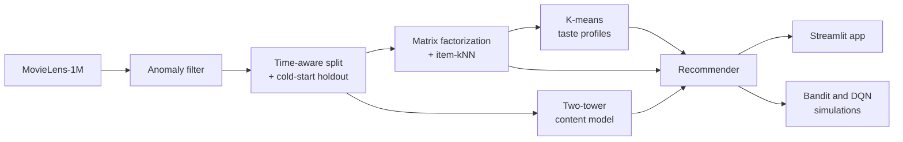

# CineMatch

A movie recommender system trained on MovieLens-1M (1,000,209 ratings from 6,040 users). It combines
collaborative filtering, a neural content model, unsupervised learning (clustering and anomaly detection)
and reinforcement learning (contextual bandits) in a single reproducible pipeline, served through a local
Streamlit application. Every reported number is produced by the evaluation script on held-out data, and
all hyperparameters are selected on a separate validation split.


## Overview

| Component | Method | Role |
|---|---|---|
| Data quality | Gaussian density model on per-user rating behaviour | Flags bot-like accounts before training |
| Collaborative filtering | Matrix factorization (PyTorch) and item-item kNN | Rating prediction and top-10 ranking |
| Content-based model | Two-tower neural network (genres, year, title) | Ranks movies that have no ratings yet |
| Taste profiles | K-means on learned user vectors | Starting point for new users |
| Strategy selection | Contextual bandit (LinUCB, epsilon-greedy) | Chooses which recommender to show, in a click simulator |
| Session ordering (exploratory) | Deep Q-network | Orders a short recommendation session |



The application has four views: recommendations from a handful of ratings (item-kNN, matrix
factorization or the content model, each with a short explanation), exploration of the taste profiles,
a live bandit simulation, and a page documenting the models and results.

## Results

<!-- RESULTS:START -->
**Summary** (held-out test data; full tables under *Detailed results*):

| Task | Method | Result | Reference |
|---|---|---|---|
| Rating prediction | Matrix factorization | RMSE 0.8887 | bias baseline 0.9323 |
| Top-10 ranking | Item-kNN | NDCG@10 0.0683 | MF + popularity prior 0.0608; popularity 0.0532; MF ranked by predicted rating 0.0287 |
| New users (5 known ratings, simulated) | Item-kNN | NDCG@10 0.0586 | popularity 0.0517 |
| Unseen movies (cold start) | Two-tower content model | NDCG@10 0.1309 | genre popularity 0.1209; random 0.0512 |
| Bot detection (synthetic bots) | Gaussian density model | F1 0.7317 (precision 0.9375, recall 0.6000) | misses 2 of 5 bot types |
| Taste profiles | K-means on MF user vectors | k = 4, silhouette 0.0656 | low silhouette: coarse segments |
| Strategy selection (simulated clicks) | Contextual bandit (LinUCB) | regret 244.9006, 37% below random (389.0596) | best single strategy in hindsight 214.9356 (not beaten) |
| Session ordering (exploratory) | Deep Q-network | 0.3407 expected clicks per session | diversity heuristic 0.4649; CF order 0.4298; random order 0.3759 |

<p>


</p>

<details>
<summary><b>Detailed results</b>: all tables, evaluation notes and figures</summary>

**Data:** MovieLens-1M, 6,040 users, 3,883 movies (183 held out as cold-start items). Split: per-user time-aware 80/10/10 train/val/test, 6% of movies with >= 20 ratings held out as cold items, seed 42: 753,429 train / 90,822 validation / 90,822 test / 65,136 cold ratings. 31 users flagged by anomaly detection are excluded from model training and from the ranking-evaluation sample (RMSE uses all held-out rows). Ranking metrics use a fixed seeded sample of 2,000 test users; a held-out rating >= 4 counts as relevant.

**Warm movies** (test split; ranking over warm candidates not in the user's train set):

| Model | RMSE | P@10 | R@10 | NDCG@10 |
|---|---|---|---|---|
| Popularity | n/a | 0.0385 | 0.0516 | 0.0532 |
| Bias baseline (mu + b_u + b_i) | 0.9323 | 0.0139 | 0.0144 | 0.0179 |
| Matrix factorization (ranked by predicted rating) | 0.8887 | 0.0216 | 0.0300 | 0.0287 |
| MF + popularity prior (beta = 1, chosen on validation) | n/a | 0.0424 | 0.0595 | 0.0608 |
| Item-kNN (k = 200, chosen on validation) | n/a | 0.0463 | 0.0680 | 0.0683 |
| Two-tower content model | 0.9839 | 0.0045 | 0.0071 | 0.0053 |

- MF: dim 32, best epoch 12 (early stopping on validation RMSE).
- Popularity has no rating prediction (RMSE n/a).
- MF + popularity prior is the same MF model ranked by predicted rating + beta x log(1 + the movie's train rating count); its rating predictions are MF's.
- Item-kNN scores a movie by its cosine similarity to the movies the user rated >= 4 (top-k neighbours per movie) + gamma x log(1 + train rating count), gamma = 0; it predicts no rating (RMSE n/a).
- beta, k and gamma were chosen by NDCG@10 on the validation split; the test split was not used to choose them.

**New users (simulated, 5 known ratings)** (test split; the app's rate-a-few-movies flow):

| Strategy | P@10 | R@10 | NDCG@10 |
|---|---|---|---|
| Popularity | 0.0368 | 0.0518 | 0.0517 |
| MF fold-in (ranked by predicted rating) | 0.0241 | 0.0312 | 0.0337 |
| MF fold-in + popularity prior | 0.0392 | 0.0567 | 0.0548 |
| Item-kNN on the liked seed movies | 0.0388 | 0.0675 | 0.0586 |

- 943 sampled users; each one's only known ratings are 5 random train ratings of well-known movies (many train ratings), scored exactly as the app scores a new user (MF fold-in, or item-kNN on the seeds rated >= 4, else >= 3, else popularity). Candidates are well-known warm movies the user has not rated in train; a test rating >= 4 counts as relevant.

**Cold-start movies** (never seen in training; MF cannot score them by construction):

| Cold-start model | RMSE | P@10 | R@10 | NDCG@10 |
|---|---|---|---|---|
| Two-tower content model | 1.0210 | 0.0997 | 0.1602 | 0.1309 |
| CF fallback: user bias only (mu + b_u, item bias unknown) | 1.0615 | n/a | n/a | n/a |
| Genre popularity (non-personalized) | n/a | 0.0951 | 0.1420 | 0.1209 |
| Random ranking (mean of 10 seeds) | n/a | 0.0398 | 0.0539 | 0.0512 |

- Ranking over cold candidates only, 1,850 sampled users with a relevant cold rating. The CF fallback row is what the bias/MF models predict for an unseen movie (item bias unknown; RMSE only, it gives every unseen movie the same score, so it cannot rank); the other rankings use exactly the same users and candidates.
- Genre and popularity priors alone (no personalization) reach NDCG@10 0.1209 vs the two-tower's 0.1309. So 87% of the two-tower's NDCG@10 gain over random comes from these priors and the rest from personalization.

**Anomaly detection:** Gaussian density over 5 behaviour features; a user is flagged when the log-density falls below a threshold epsilon chosen by validation F1. Test set: 150 synthetic bots + held-out real users. Real users flagged and excluded: 31.

| Metric | 5 features (deployed) | + item-deviation feature (ablation) |
|---|---|---|
| Validation F1 | 0.7317 | 0.7317 |
| Test precision | 0.9375 | 0.9184 |
| Test recall | 0.6000 | 0.6000 |
| Test F1 | 0.7317 | 0.7258 |
| Recall on `push` bots | 1.0000 | 1.0000 |
| Recall on `nuke` bots | 1.0000 | 1.0000 |
| Recall on `random_spam` bots | 0.0000 | 0.0000 |
| Recall on `camouflage_popular` bots | 0.0000 | 0.0000 |
| Recall on `camouflage_slow` bots | 1.0000 | 1.0000 |

- Bot types the deployed model misses (test recall below 0.5): `random_spam`, `camouflage_popular`.
- Ablation: the same protocol with a 6th engineered feature, the mean absolute deviation of a user's ratings from each movie's mean, tried after error analysis on validation bots. It did not improve test F1 (0.7258 vs 0.7317): the missed bots mimic real users' rating statistics, so catching them needs item-level / co-rating graph signals. Test bots come from the same synthetic generator, so this measures detection of these patterns, not real-world abuse.

**Taste profiles:** K-means on MF user vectors, k = 4 (silhouette 0.0656): Action & Sci-Fi fans (1,174), Mainstream (1,901), Romance & Children's fans (1,324), Drama & Film-Noir fans (1,641).

**Contextual bandit** (20,000 rounds x 5 seeds, simulated clicks):

| Policy | Mean reward | Cumulative regret (± std) |
|---|---|---|
| Random | 0.0262 | 389.0596 ± 7.9565 |
| Epsilon-greedy | 0.0337 | 240.0854 ± 13.9208 |
| LinUCB | 0.0334 | 244.9006 ± 16.8127 |
| Always the best single arm (CF; reference, not a learner) | 0.0349 | 214.9356 ± 3.0395 |

- Neither learner beats always serving the best single strategy (CF) within 20,000 rounds, so the user context does not pay off yet in this simulation.
- LinUCB and epsilon-greedy differ by less than two standard errors over 5 seeds, i.e. within seed noise.
- Hyperparameters tuned on 1,000 simulated users disjoint from the reported ones (lowest mean cumulative regret): LinUCB alpha = 0.01, epsilon-greedy epsilon = 0.05.
- 59.6% of simulated users have no click signal (none of their arms' lists contains a movie they rated in the test split, so every arm has the same expected reward); only the remaining users can separate the policies.

**DQN stretch goal** (order a 5-slot session from 8 CF candidates; simulated position decay and genre fatigue make the order matter):

| Ordering policy | Mean expected session reward |
|---|---|
| DQN (greedy policy) | 0.3407 |
| Diversity heuristic | 0.4649 |
| CF order | 0.4298 |
| Random order (mean of 20 orders) | 0.3759 |
| Oracle (best 5-item sequence per user, upper bound) | 0.8199 |

- Expected (analytic) clicks per session on 128 held-out users with click signal; the DQN was trained on 128 other users for 3,000 episodes. Only 256 of 1,000 simulated users (26%) have any click signal among the candidates.
- On held-out users the DQN does not beat the diversity heuristic and CF order and random order.

**Further details:**

- Anomaly threshold: log-density epsilon -17.7395 (chosen by validation F1); ablation epsilon -25.5033.
- Bandit: oracle mean reward 0.0458; mean expected reward per arm: CF 0.0352, content 0.0126, taste-profile favourites 0.0334, trending 0.0248.
- Tuning grid for LinUCB alpha (mean cumulative regret on the tuning users): 1: 266.1725, 0.3: 236.0220, 0.1: 231.6335, 0.03: 223.1720, 0.01: 203.0455.
- Tuning grid for epsilon-greedy epsilon (mean cumulative regret on the tuning users): 0.2: 241.3590, 0.1: 206.4155, 0.05: 205.3950, 0.02: 263.3275.

Training time: 100s, the sum of the step times (anomaly 3s, data 6s, cf 25s, content 23s, clustering 3s, bandit 17s, dqn 24s).

**More figures:**

<p>


</p>

</details>

_Generated by `scripts/evaluate.py` at 2026-10-19T15:44:12+00:00 from `reports/metrics.json`._
<!-- RESULTS:END -->

## Key findings

- **Rating accuracy is not ranking quality.** Matrix factorization has the lowest rating error, but when
  movies are ranked by predicted rating the order is dominated by each movie's average-rating bias, which
  favours little-watched films and underperforms a popularity baseline. Adding a popularity prior, or
  ranking with item-kNN, corrects this; both are tuned on validation data.
- **Cold-start recommendations rely largely on priors.** The content model ranks unseen movies far above
  random, but a non-personalised genre-popularity ranking accounts for most of that gain.
- **Camouflaged bots evade summary-statistic detection.** Bots with extreme rating patterns are detected
  reliably; two camouflaged types are not, and an additional engineered feature did not close the gap.
- **Context does not yet pay off in the bandit simulation.** Both learners improve substantially on
  random selection but do not beat serving the single best strategy, largely because most simulated users
  provide no click signal. The exploratory DQN likewise does not outperform simple ordering rules.

## Methodology

- **Data and splits:** each user's ratings are split by time (80/10/10 train/validation/test), and a
  random 6% of movies with at least 20 ratings is held out entirely to evaluate cold-start
  recommendation. Seed 42 throughout.
- **Evaluation:** RMSE for rating prediction; Precision, Recall and NDCG@10 for ranking (a held-out rating
  of 4 or more counts as relevant) on a fixed sample of 2,000 test users; a simulation of new users with
  five known ratings, matching the application; exact expected regret for the bandit.
- **Model selection:** training epochs by validation RMSE; the ranking prior weight and the kNN
  neighbourhood size by validation NDCG@10; bandit hyperparameters on simulated users disjoint from those
  reported; the anomaly threshold by validation F1. The test split is never used for selection.
- **Data quality:** anomaly detection runs first; flagged users (capped at 3% of users) are excluded from
  training and from the evaluation sample. Its accuracy is measured on synthetic bots injected into a
  copy of the data.
- **Reproducibility:** one command trains every model (about two minutes on a laptop CPU) and one
  regenerates all metrics, figures and the Results section above.

## Limitations and future work

- Bandit and DQN rewards come from a click simulator built on held-out ratings, not from observed user
  behaviour; off-policy evaluation on logged interactions would be a stronger test.
- The split is time-ordered within each user only, so training contains other users' later ratings; a
  global temporal split would be stricter.
- The synthetic bots used for validation and test come from the same generator, so detection of real
  abuse is not measured; item-level or co-rating graph features are a natural next step.
- Item content is limited to genres, year and title; text embeddings of plot summaries could strengthen
  cold-start personalisation.
- Only accuracy is evaluated; diversity, novelty and catalogue coverage are not.

## Running locally

Requires Python 3.11.

```powershell
# Windows (PowerShell)
py -3.11 -m venv .venv
.venv\Scripts\python.exe -m pip install -r requirements.txt
.venv\Scripts\python.exe scripts\download_data.py
.venv\Scripts\python.exe scripts\train_all.py; if ($?) { .venv\Scripts\python.exe scripts\evaluate.py }
.venv\Scripts\python.exe -m streamlit run app\streamlit_app.py
```

```bash
# macOS / Linux
python3.11 -m venv .venv && source .venv/bin/activate
pip install torch==2.14.1 --index-url https://download.pytorch.org/whl/cpu
pip install -r requirements.txt
python scripts/download_data.py
python scripts/train_all.py && python scripts/evaluate.py
streamlit run app/streamlit_app.py
```

Run the tests with `pytest -q`. Setting `TMDB_API_KEY` adds movie posters to the application.
`--fast` runs a quick smoke version of training and evaluation (its numbers overwrite the Results section).

## Repository structure

| Path | Contents |
|---|---|
| `src/cinematch/data.py` | Loading, time-aware split, cold-start holdout, item features: `split_ratings`, `build_item_features` |
| `src/cinematch/anomaly.py` | Gaussian anomaly detection and synthetic bots: `user_features`, `inject_bots`, `fit_gaussian`, `select_epsilon` |
| `src/cinematch/cf.py` | Bias baseline, matrix factorization, popularity prior, item-kNN: `BiasBaseline`, `train_mf`, `rank_scores`, `build_item_knn` |
| `src/cinematch/content.py` | Two-tower content model: `build_two_tower`, `train_two_tower` |
| `src/cinematch/clustering.py` | K-means taste profiles: `fit_kmeans_range`, `choose_k`, `name_clusters` |
| `src/cinematch/bandit.py` | Click simulator and bandit policies: `BanditEnv`, `EpsilonGreedy`, `LinUCB`, `run_all` |
| `src/cinematch/dqn.py` | Deep Q-network for session ordering: `train_dqn`, `diversity_orders` |
| `src/cinematch/recommend.py` | Numpy-only inference used by the application: `Recommender` |
| `src/cinematch/metrics.py` | RMSE, Precision/Recall/NDCG@10: `rmse`, `rank_eval` |
| `scripts/`, `app/`, `tests/` | Pipeline entry points, Streamlit application, test suite |

## License

Code is released under the MIT License. MovieLens-1M is provided by GroupLens Research under its own
terms; it is downloaded by `scripts/download_data.py` and not redistributed here.
