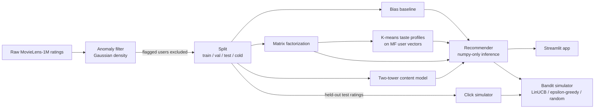

# CineMatch

CineMatch is a movie recommender built on MovieLens-1M that wires five machine-learning
ML modules into one reproducible pipeline: anomaly detection removes bot-like users,
collaborative filtering (matrix factorization) is the core recommender, a two-tower content
model handles brand-new movies, K-means taste profiles handle brand-new users, and a
contextual bandit learns which strategy to show each user. One command trains everything,
one command evaluates everything and writes every number in this README.

**Live demo:** [Demo on Hugging Face Spaces](https://huggingface.co/spaces/<user>/cinematch) (placeholder)

**Screenshot:** (screenshot placeholder)
<!--  -->

## What it does (30-second version)

- **Anomaly detection** — a Gaussian density model over per-user behaviour features flags bot-like raters (validated against injected synthetic bots) and keeps them out of training.
- **Collaborative filtering** — matrix factorization (user/item vectors + biases) trained in PyTorch, compared against a bias baseline and a popularity baseline.
- **Content-based two-tower model** — genre, year and title features let it score movies nobody has rated yet (cold-start items).
- **Taste profiles** — K-means on the MF user vectors gives named clusters ("Horror & Thriller fans") that serve new users who pick a profile. The elbow plot is shown for transparency; the silhouette score decides k.
- **Contextual bandit** — LinUCB vs epsilon-greedy vs random choose which strategy fills a user's list, scored by a click simulator built from held-out ratings.

## Architecture



## Results

All numbers below are written by `scripts/evaluate.py` from `reports/metrics.json`; nothing is hand-typed.

<!-- RESULTS:START -->
_Results are generated by `python scripts/evaluate.py` (not run yet in this commit)._
<!-- RESULTS:END -->

Key figures (generated into `reports/figures/`): `cf_training.png`, `clusters_pca.png`,
`anomaly_scores.png`, `bandit_regret.png`.

**Why Popularity can beat MF on top-N:** MovieLens has a strong popularity bias (users
rate, and like, well-known movies far more often than obscure ones), and MF is trained to minimise rating
error (RMSE), not to rank. A low RMSE therefore does not guarantee the best top-10 list;
both numbers are reported as measured.

## ML techniques -> where they are used

| Technique | Where in the code |
|---|---|
| Collaborative filtering / matrix factorization | `src/cinematch/cf.py` |
| Content-based filtering (two-tower network) | `src/cinematch/content.py` |
| K-means clustering, elbow + silhouette | `src/cinematch/clustering.py` |
| PCA (2-D visualisation of taste profiles) | `src/cinematch/clustering.py` |
| Anomaly detection (Gaussian density, epsilon chosen by F1) | `src/cinematch/anomaly.py` |
| Reinforcement learning (contextual bandit, LinUCB; DQN stretch) | `src/cinematch/bandit.py`, `src/cinematch/dqn.py` |

## Design decisions

1. **Dataset:** MovieLens-1M (6,040 users, ~3,900 movies, 1,000,209 ratings); downloaded by `scripts/download_data.py`, never committed (GroupLens license).
2. **Split:** per-user time-aware holdout: each user's ratings sorted by timestamp; last 10% -> test, previous 10% -> validation, rest -> train (every ML-1M user has >= 20 ratings, so each user has >= 2 test and >= 2 val ratings). Seed 42 everywhere.
3. **Cold-start items:** 6% of movies with >= 20 ratings are held out entirely (all their ratings removed from train/val/test and placed in a `cold` split). Only the two-tower model is evaluated on them; CF cannot score unseen items by construction.
4. **Anomaly detection runs first:** Gaussian density on per-user behaviour features (computed from raw ratings before splitting) is fitted on a 60% sample of real users, epsilon is tuned on a validation set of real users plus synthetic bots, and flagged real users (capped at 3%) are removed from CF/content training and from the shared evaluation-user sample (their MF vectors are untrained, so scoring them would be meaningless); they stay in `ratings_split` so the app can still serve them.
5. **Relevance for ranking metrics:** a held-out rating >= 4 counts as relevant; candidates = all warm items not in the user's train set; metrics are P@10, R@10, NDCG@10 (binary gain) plus RMSE on held-out ratings. A Popularity baseline is reported and may beat MF on top-N; we report it as measured.
6. **CF = classic MF** (user/item vectors + biases + global mean, regularized MSE) trained with mini-batch Adam in PyTorch, early stopping on validation RMSE. Baseline = global mean + regularized user/item biases (closed form, alternating).
7. **Two-tower** uses only genre multi-hot + scaled year + a title TF-IDF->SVD(16) vector for items (no sentence-transformers: no extra deps, offline-friendly), and rating-derived profile features for users; dot-product + global bias trained on rating MSE.
8. **Taste profiles:** K-means on L2-normalised CF user vectors, k in 2..12; k chosen by the best silhouette among k with >= 3% of users in every cluster, capped at 8 for readability; names come from genre lift of each cluster's highly-rated movies.
9. **Bandit clicks are simulated**, not real: p(click | test-split rating r) = {1:0.02, 2:0.05, 3:0.15, 4:0.45, 5:0.75}; unrated item p = 0.01 (validation ratings are never used, since they tuned early stopping). Regret is exact (expected reward per arm per user is computed analytically).
10. **App inference is numpy-only** (weights exported to `.npz`); new users are folded in with closed-form ridge regression against frozen item vectors.
11. **DQN is a stretch**; if not shipped the README says so explicitly.
12. **Every number in the README is written by `scripts/evaluate.py`** between `<!-- RESULTS:START -->` / `<!-- RESULTS:END -->`; nothing is hand-typed.

Notes: the title TF-IDF/SVD features are fit on all movie titles (including cold items); this
is unsupervised metadata, not ratings, so no rating information leaks into the cold split.
Flagged users are excluded from model fitting and from the 2,000-user ranking-evaluation sample.

## Limitations

- **Clicks are simulated** from held-out ratings, not logged from real users; bandit results show the method works, not real-world uplift.
- **MF cannot score cold items** (movies with no training ratings); only the two-tower model covers them.
- **Anomaly bots are synthetic** (five injected behaviour patterns); real-world abuse may look different. Many real ML-1M users rated everything in a single session, so a high ratings-per-day rate alone is only weakly anomalous; the model relies on combinations of features.
- **Ranking metrics use a sample:** a fixed seeded sample of 2,000 test users, so all models are compared on identical users.
- **Thin item content:** genres, year and title only — no plot overviews or sentence embeddings.
- **Flagged users** are excluded from training and evaluation, so their MF vectors are untrained; the app serves them through the content model and their nearest taste profile.

## How to run locally

Windows PowerShell (PowerShell 5.1 has no `&&`, so commands are chained with `;`):

```powershell
python -m venv .venv
.venv\Scripts\python.exe -m pip install -r requirements.txt
.venv\Scripts\python.exe scripts\download_data.py
.venv\Scripts\python.exe scripts\train_all.py; .venv\Scripts\python.exe scripts\evaluate.py
.venv\Scripts\python.exe -m streamlit run app\streamlit_app.py
.venv\Scripts\python.exe -m pytest -q
```

macOS / Linux (bash):

```bash
python -m venv .venv && source .venv/bin/activate
pip install -r requirements.txt
python scripts/download_data.py
python scripts/train_all.py && python scripts/evaluate.py
streamlit run app/streamlit_app.py
pytest -q
```

- **Smoke mode:** `python scripts/train_all.py --fast` and `python scripts/evaluate.py --fast` run in a fraction of the time with tiny epochs. Warning: a fast evaluate overwrites `reports/metrics.json` and the README results block with non-final numbers (marked with a FAST MODE banner); rerun the full `train_all.py` + `evaluate.py` before committing.
- **Posters (optional):** set `TMDB_API_KEY` to show posters from TMDB; without it the app uses offline placeholders.
- **PyTorch on CPU:** `requirements.txt` pins `torch` without a `+cpu` suffix so it installs on Windows from PyPI; the Dockerfile installs the CPU wheel from the PyTorch index first.

## Deployment

Primary target: **Hugging Face Spaces (Docker SDK)**. The `Dockerfile` downloads the data,
trains all models and runs `evaluate.py` at build time, then serves Streamlit on port 7860
(the YAML header at the top of this file is the Space configuration). Streamlit Community
Cloud is possible only if you accept committing derived artifacts (`models/`,
`data/processed/`), which is not done here.

## Repo layout

```
cinematch/
  README.md, requirements.txt, pyproject.toml, Dockerfile, .streamlit/config.toml
  src/cinematch/
    config.py        paths, seed, hyperparameters (Config dataclass, --fast mode)
    data.py          loading, cold-item holdout, per-user time split, artifacts
    metrics.py       RMSE, P@10, R@10, NDCG@10
    anomaly.py       Gaussian anomaly detection + synthetic bots
    cf.py            bias baseline, matrix factorization, popularity
    content.py       two-tower content model
    clustering.py    K-means taste profiles, PCA
    bandit.py        click simulator, random / epsilon-greedy / LinUCB
    dqn.py           DQN stretch goal (optional)
    recommend.py     numpy-only Recommender used by the app and the bandit
    readme_fill.py   writes the results block of this README
  scripts/
    download_data.py train_all.py evaluate.py
  app/streamlit_app.py
  tests/             pytest suite (synthetic data, runs in seconds)
  reports/           metrics.json + figures/ (written by evaluate.py)
  data/, models/     generated locally, not committed
```

## DQN stretch goal

Status is rendered automatically in the Results section above (from `reports/metrics.json`,
key `dqn`): either the DQN session-recommendation results or "not shipped".

## License

Code: MIT. MovieLens-1M data is provided by GroupLens Research under its own terms of use;
it is downloaded at build/run time and never redistributed in this repository.
